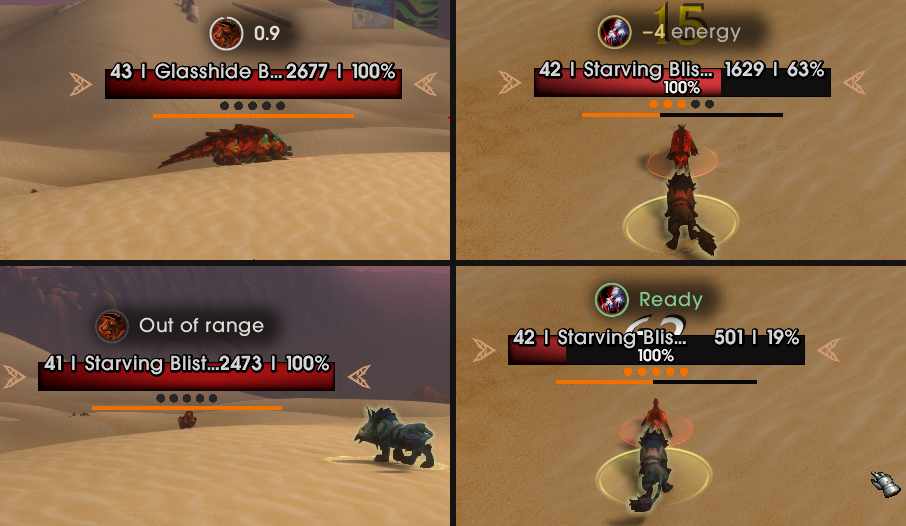
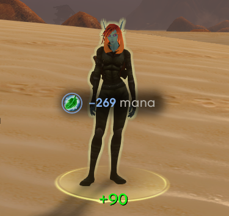
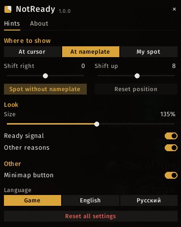

# NotReady: Cooldown & Resource Hints

Shows why a skill didn't go off in WoW Forever: seconds of cooldown left or how much rage, mana or energy you're missing. You see the number when you press the key, so you can stop spamming it and wait.

## What you see

Press a skill on your action bars that can't go off, by key or by mouse, and a small hint appears with its icon.

- On cooldown, it shows the time left: whole seconds, and tenths under 3 seconds. A ring around the icon fills up until the skill is ready.
- Short on a resource, it shows how much is missing, like −4 energy or −269 mana.
- For any other reason, it shows the game's own text, like "Out of range" or a wrong stance.

A hint stays for 2 seconds after your last press and then fades. Up to 3 skills show at once. The global cooldown on its own shows nothing.

## Ready signal

If the skill you pressed becomes available within 15 seconds, a green **Ready** shows in the same place for 0.7 seconds. You can turn it off.

## Where it shows

You pick one of three places in the settings:

- **At cursor** keeps the hints next to your mouse.
- **At nameplate** puts them above your target's nameplate. With no nameplate, they appear at your spot.
- **My spot** (the default) keeps them in one place on the screen, just under your character.

**Choose a spot on screen** (**Spot without nameplate** in nameplate mode) hides the settings so you can drag the hints anywhere. They snap to the center line of the screen when you get close. **Done** saves the spot, **Cancel** or Escape puts it back.

**Shift right** and **Shift up** set the position by number: from the cursor or the nameplate (−300 to 300), or from the center of the screen for your spot. **Reset position** puts the current place back to its default.

## Settings

`/notready` or the minimap button opens the settings. Example hints stay on screen while they are open, so you see every change.

- **Size** is 135% by default (60% to 200%).
- **Ready signal** and **Other reasons** are on by default.
- You can also hide the minimap button and switch the language between the game's, English and Russian.
